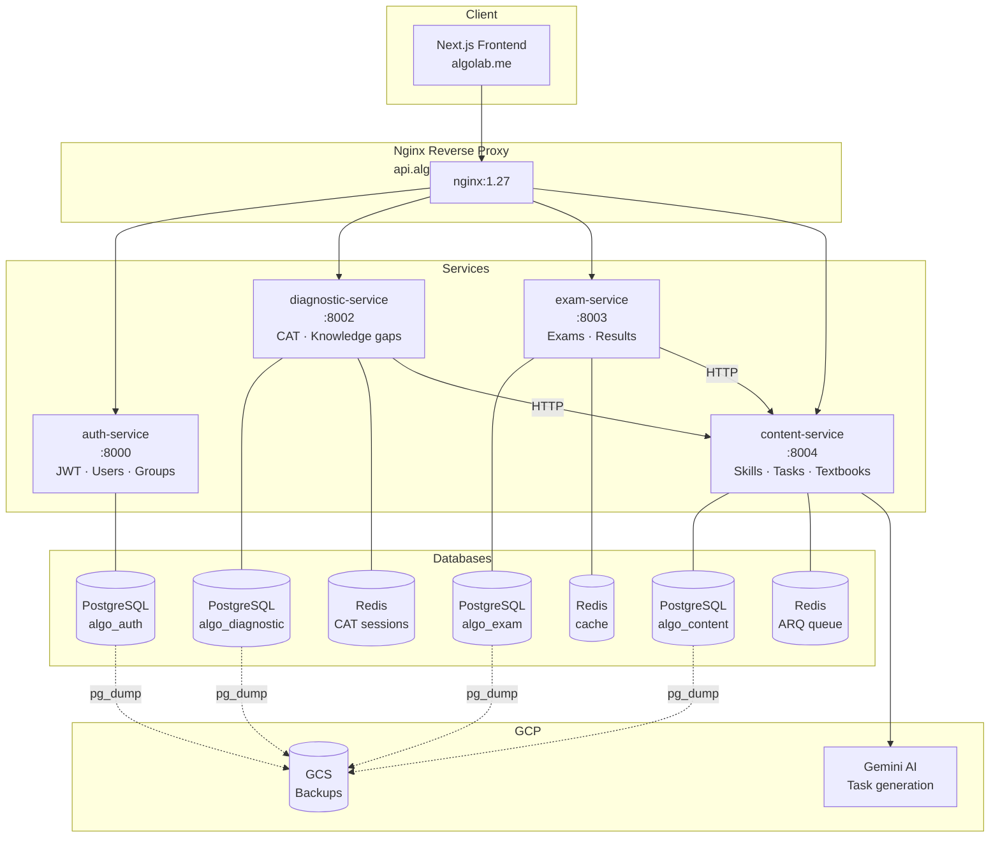

# ALGO — Adaptive Learning & Grade-Output Platform

ALGO — образовательная платформа для казахстанских школьников. Диагностирует пробелы в знаниях и генерирует персонализированные учебные планы на основе учебной программы.

## Архитектура



## Сервисы

| Сервис | Порт | Назначение | БД |
|---|---|---|---|
| auth-service | 8000 | Аутентификация, организации, студенты, группы | algo_auth |
| diagnostic-service | 8002 | CAT-диагностика, карта знаний | algo_diagnostic |
| exam-service | 8003 | Экзамены, черновики, результаты | algo_exam |
| content-service | 8004 | Учебный граф, банк задач, загрузка учебников | algo_content |

## Быстрый старт (local dev)

### Требования
- Docker Desktop ≥ 24
- Python 3.11+ (для smoke-тестов)

### 1. Создать общую сеть
```bash
docker network create algo-network
```

### 2. Запустить все сервисы
```bash
# Из каждой папки сервиса:
cd auth-service      && docker compose up -d --build && cd ..
cd diagnostic-service && docker compose up -d --build && cd ..
cd exam-service      && docker compose up -d --build && cd ..
cd content-service   && docker compose up -d --build && cd ..
```

### 3. Проверить
```bash
python3 scripts/smoke_test.py
# Expected: 10 passed, 0 failed
```

## Health endpoints

Каждый сервис предоставляет:

| Endpoint | Описание | HTTP-код |
|---|---|---|
| `GET /health/live` | Liveness — сервис жив, без проверки зависимостей | 200 |
| `GET /health/ready` | Readiness — DB + Redis доступны | 200 / 503 |
| `GET /metrics` | Prometheus metrics | 200 |

> content-service: `/api/v1/health/live`, `/api/v1/health/ready`

## Мониторинг

Prometheus scrape targets (добавить в `prometheus.yml`):
```yaml
scrape_configs:
  - job_name: algo-auth
    static_configs: [{targets: ["algo-auth:8000"]}]
  - job_name: algo-diagnostic
    static_configs: [{targets: ["algo-diagnostic:8002"]}]
  - job_name: algo-exam
    static_configs: [{targets: ["algo-exam:8003"]}]
  - job_name: algo-content
    static_configs: [{targets: ["content-api:8004"]}]
```

## CI/CD

GitHub Actions (`.github/workflows/ci.yml`) запускается на каждый PR:

| Job | Описание |
|---|---|
| `lint` | ruff по всем 4 сервисам |
| `test-auth` | pytest + coverage ≥60% (PostgreSQL + Redis service containers) |
| `test-exam` | pytest unit tests |
| `docker-build` | `docker buildx build` для всех 4 образов |

## Деплой на GCP VM

```bash
# 1. SSH на VM
gcloud compute ssh algo-vm --zone=us-central1-a

# 2. Клонировать репо
git clone https://github.com/your-org/algo.git /opt/algo && cd /opt/algo

# 3. Создать .env файлы для каждого сервиса (см. README каждого сервиса)

# 4. Создать Docker сети
docker network create algo-network
docker network create algo-back_algo-network

# 5. Запустить сервисы
cd auth-service      && docker compose -f docker-compose.prod.yml up -d && cd ..
cd diagnostic-service && docker compose -f docker-compose.prod.yml up -d && cd ..
cd exam-service      && docker compose -f docker-compose.prod.yml up -d && cd ..
cd content-service   && docker compose -f docker-compose.prod.yml up -d && cd ..

# 6. Запустить Nginx + Certbot
cd nginx && docker compose -f docker-compose.nginx.yml up -d
```

## Бэкапы БД

```bash
# Ежедневно в 03:00 (настроить на VM):
echo "0 3 * * * root /opt/algo/scripts/backup_postgres.sh >> /var/log/algo-backup.log 2>&1" \
  > /etc/cron.d/algo-pg-backup

# GCS lifecycle (30 дней):
gsutil lifecycle set scripts/gcs-lifecycle.json gs://algo-backups-algo-495713
```

## GCP

- Project: `algo-495713`
- Region: `us-central1`
- Domain: `algolab.me`

## Roadmap

См. [ROADMAP.md](ROADMAP.md)
